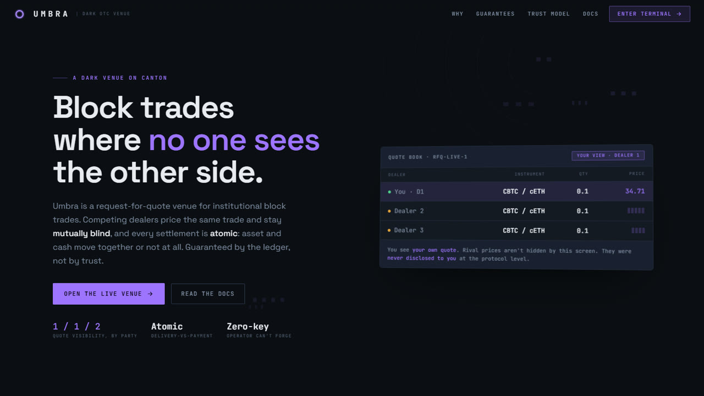
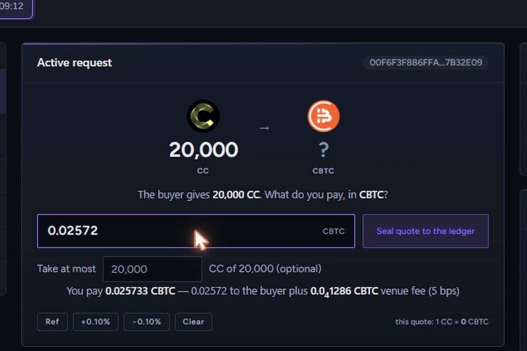
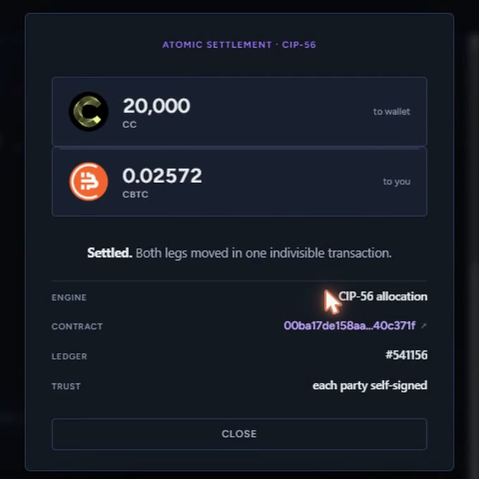
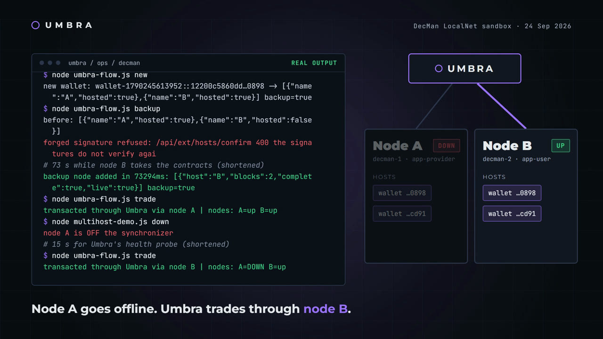
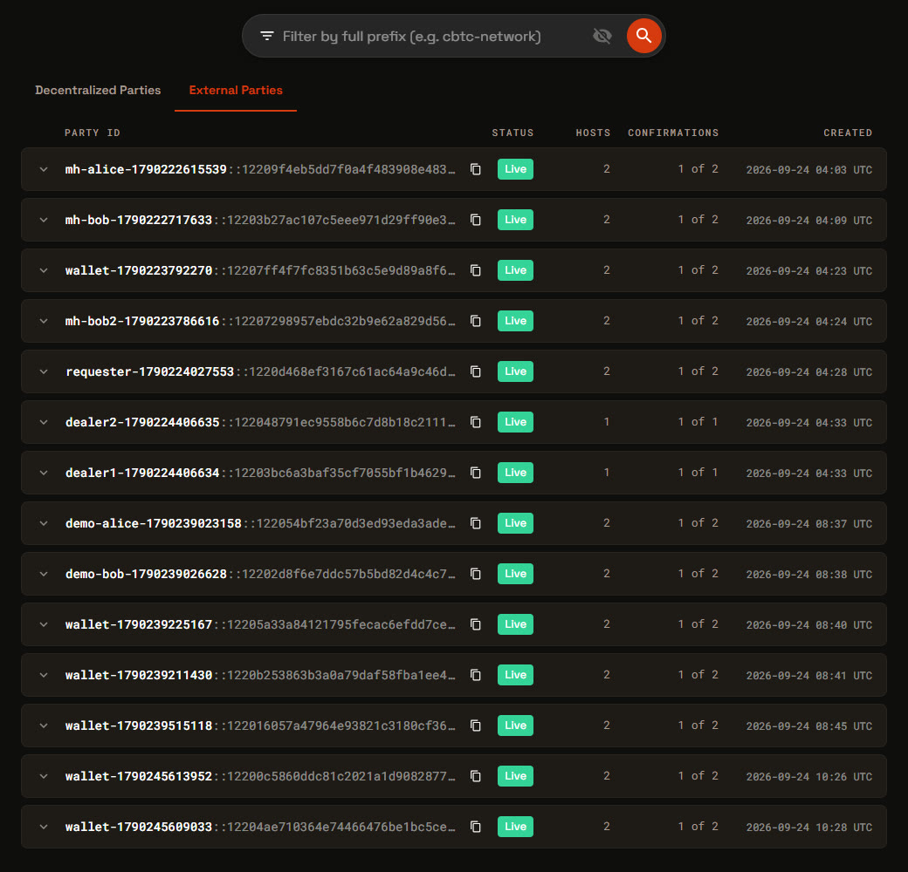
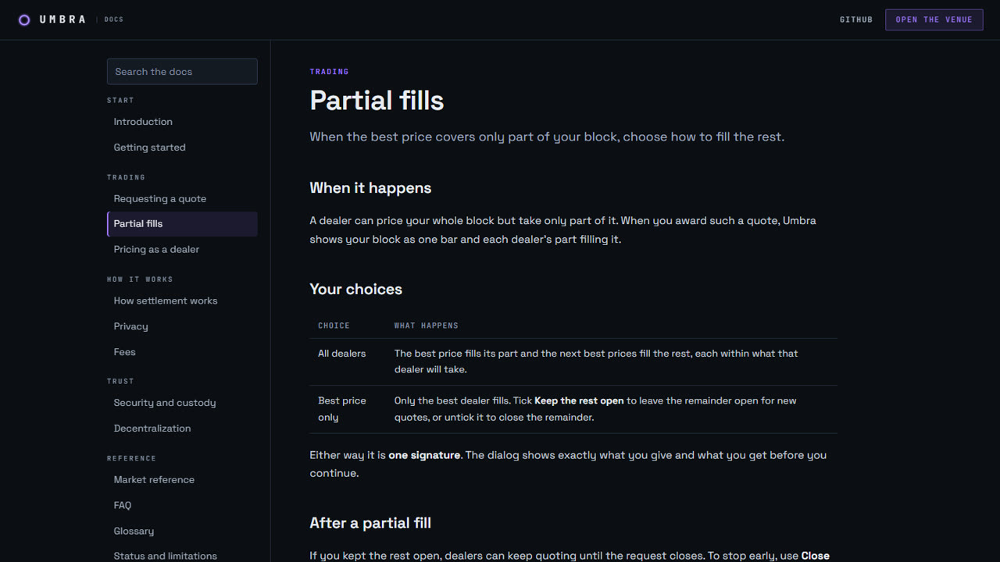

# Umbra

**A private, non-custodial OTC venue for block trades, built on Canton.**

Umbra is a dark request-for-quote (RFQ) venue. A buyer privately asks chosen dealers to
price a block. The dealers are **blind to one another**: a rival's quote is never *sent* to a
competing dealer, because Canton withholds it at the ledger, not in the frontend. The winning
trade settles as one **atomic swap of real registry-issued assets**, with the venue fee in the
same transaction: every leg moves, or none does.

> Every public blockchain leaks block trades. Order flow, counterparties and size are visible
> to anyone, which is why institutions cannot use them for real size. Canton was built to fix
> exactly this. **Umbra is the proof.**

**HackCanton** · Financial Applications: DeFi, Exchanges & Prediction Markets ·
BitSafe Decentralization Manager tracks



---

## Contents

- [Links](#links)
- [What works today](#what-works-today)
- [See it](#see-it)
- [Proof, not claims](#proof-not-claims)
- [How a trade flows](#how-a-trade-flows)
- [The guarantees](#the-guarantees)
- [Why this can only work on Canton](#why-this-can-only-work-on-canton)
- [Staying up when a node goes down](#staying-up-when-a-node-goes-down)
- [BitSafe tracks: what we deliver](#bitsafe-tracks-what-we-deliver)
- [Security](#security)
- [Architecture](#architecture)
- [Running it](#running-it)
- [Asset integration status](#asset-integration-status)
- [Roadmap](#roadmap)

---

## Links

| | |
|---|---|
| **Current release** | Live on Canton DevNet at https://um-bra.app/ — test assets and unaudited contracts; do not connect a wallet holding anything you care about |
| **Previous release** | Branch `v2`, no longer deployed — https://um-bra.app/ now serves the current release |
| **User docs** | Served by the app at `/docs`: getting started, trading, settlement, privacy, fees, security |
| **Contact** | https://x.com/UmbraOnCanton |
| **Demo (earlier release)** | https://youtu.be/bclZUlSeiE0?si=w7SfAyIYbb5juLzF |
| **Deck** | [Presentation](https://docs.google.com/presentation/d/1WoZ2BQWhdrjZlP-PPh5HQ4Jc2g2BCceG/edit?usp=sharing&ouid=111114609282721158539&rtpof=true&sd=true) |
| **Multi-node guide** | [docs/DECENTRALIZATION.md](docs/DECENTRALIZATION.md) |
| **Governed actions** | [docs/GOVERNANCE.md](docs/GOVERNANCE.md) |
| **What is real, what is not yet** | [docs/HONESTY.md](docs/HONESTY.md) |

---

## What works today

On Canton DevNet, on our own validator, against the real token registries:

**Trading**
- **A full trade in one approval per side.** A dealer's quote locks its payment and the venue
  fee in the same signature (a *firm quote*). The buyer's award locks its own side in one
  signature. Every leg is then in, and the venue settles. Nobody comes back to sign again.
- **Real assets, atomically.** CBTC (BitSafe's registry) against Canton Coin (the DSO's). The
  payment, the offer and the venue fee move in one transaction, or nothing moves.
- **Partial fills across several dealers.** A dealer can cap how much of a block it takes. The
  buyer sees each quote's fill, rate and real payout, then fills the block from the best price
  and the next best in one signature, or takes only the best price and keeps the rest open.
  One receipt shows the whole fill, with each dealer's share.
- **Close a request any time.** One signature ends it and sends every dealer's locked funds home.
- **Expired locks come home by themselves**, inside each side's next request, quote or close,
  never by the venue (which would otherwise see the losing quote).

**Privacy and custody**
- **Blind quoting, checked on the ledger.** Queried as the venue's own party, the ledger shows
  zero quotes and zero of their locks. The buyer sees every quote on its request; each dealer
  sees only its own.
- **Non-custodial.** Every lock sits in its owner's wallet at the registry. It can execute only
  as the deal both sides signed, or go back to its owner.
- **Bring your own wallet.** Loop, and wallets reached through PartyLayer or the Canton dApp
  SDK. The wallet's key never comes to Umbra: it signs a sign-in message and transaction
  hashes, nothing more.
- **Every transaction checked before a wallet signs it.** The page recomputes the hash with
  Canton's own code and checks who it acts for, what it does and the user's own numbers. A
  server that built the wrong transaction is refused before the wallet is asked.

**Operations**
- **Venue keys isolated.** A separate signer process, as its own OS user, holds the venue's
  keys. It decodes every transaction and signs only settlement, cancel, resize and listing
  actions; anything else is refused.
- **Several nodes.** The venue's party and its users' parties can be hosted on more than one
  node through BitSafe's Decentralization Manager, and the server fails over between nodes.
- **An admin dashboard** at `/admin`, behind a password: volume, trades, users, fees, a
  leaderboard with CSV export, and campaign tags written onto each receipt on the ledger.
- **A DevNet test-CC faucet** at `/faucet`: up to 5,000 CC per party a day, with a
  proof-of-work check.

Where a claim ran on one machine rather than on DevNet, [docs/HONESTY.md](docs/HONESTY.md) says so.

---

## See it

| A dealer prices a block | The trade settles |
|---|---|
|  |  |
| The dealer sees exactly what it pays, fee included, before one signature seals the quote and locks the funds behind it. | Both legs and the fee in one transaction on DevNet. Each party signed with its own wallet. |

| Node A goes down; Umbra keeps trading | Node B's Decentralization Manager |
|---|---|
|  |  |
| A real run on BitSafe's LocalNet sandbox: node A is cut off, the next trade goes through node B. | The same run seen from node B: every wallet hosted on 2 nodes, live. |



---

## Proof, not claims

| Claim | Evidence |
|---|---|
| Real atomic settlement on DevNet | Ledger transactions **#541156** (20,000 CC for 0.02572 CBTC), **#536287**, **#504456**, each settled by `SettleDeal` with every leg and the fee in one transaction |
| One signature per side | The firm-quote flow: `SubmitFirmQuote` locks the dealer's side, `AwardFirm` locks the buyer's, the venue settles |
| The venue never sees a losing quote | Queried as the venue's party: 0 `FirmQuote` contracts, 0 of their locks |
| The venue cannot sign for anyone | External parties; the venue signer refuses any transaction not acting for the venue (tested against a real user transaction) |
| Failover | Node A disconnected from the synchronizer on the sandbox; Umbra traded through node B, then returned to A |
| A trade with the venue's node switched off | DevNet, 6 Oct: `splice-validator-participant-1` stopped 1h 52m; BitSafe's node committed all three legs. Update `1220fa44b5a8…`, settled 13:21:50Z, five balances reconciled exactly, zero locked holdings. A manual relay, not automatic failover |
| Contract correctness | **102 Daml Script tests** and **56 backend tests**, run by CI on every push |
| The package is what we say it is | `umbra-v9 0.13.0`, package id `4436f5dd…`, SHA-256 `fba04a1b…10be1e`, reproducible from this repo |

---

## How a trade flows

```
Requester                         Umbra                     Dealer A        Dealer B
    |-- open request (1 signature) -->|                          |               |
    |   offer 0.5 CBTC, want CC       |--- invitation ---------->|               |
    |                                 |--- invitation --------------------------->|
    |                                 |<-- firm quote: price + locked payment + locked fee (1 signature)
    |                                 |<-- firm quote ----------------------------|
    |   sees both; A and B cannot see each other's quote, or that it exists
    |-- hold to award (1 signature) ->|   takes A's quote, locks the requester's 0.5 CBTC,
    |                                 |   sends B's locks home, in one transaction
    |                                 |== venue settles: CBTC -> A, CC -> requester, fee -> vault ==
```

Nothing moves until every leg is locked, and then everything moves together. If a lock
deadline passes first, the venue cancels the deal and every lock goes back to its owner.

---

## The guarantees

| # | Guarantee | How it is enforced |
|---|---|---|
| P1 | **No information leakage.** Dealers are blind to each other, and the venue to losing quotes | Canton signatory and observer rules. A firm quote is `signatory dealer, observer requester`; its locks name the dealer, not the venue, as executor |
| P2 | **Atomic DvP.** Every leg settles or none does | `SettleDeal` exercises `Allocation_ExecuteTransfer` on the offer, the payment and the fee in one transaction, after checking each against the deal's terms |
| P3 | **Self-signed.** No party's authority is held by the venue | External parties: prepare, sign in the owner's wallet, execute. The venue signs only its own role |
| P4 | **CIP-56 throughout** | Holdings and locks are the registry's own `Holding` and `Allocation` interfaces, compiled against the registry's exact packages |
| P5 | **Non-custodial locks** | A lock executes only as the signed deal, or is cancelled or withdrawn back to its owner |
| P6 | **Sound settlement.** An underfunded trade is refused, not minted | The registry refuses a lock it cannot cover; `SettleDeal` refuses a leg that is not the agreed one |
| P7 | **Expiry is ledger-enforced** | Quoting after the request closes fails a Daml assertion against ledger time |
| P8 | **Firmness is ledger-enforced** | A quote past its `validUntil` cannot be taken |

Every guarantee has a headless test (see [Running it](#running-it)).

---

## Why this can only work on Canton

1. **Sub-transaction privacy.** A quote is disclosed only to its stakeholders. Dealer A's price
   is not hidden from Dealer B; it is **never sent to them**. On a transparent chain this venue
   cannot exist.
2. **Atomic multi-party settlement.** Every leg moves in one indivisible transaction: no
   settlement risk, no escrow, no moment where one side has delivered and the other has not.
3. **Self-custody.** Each party signs with its own key. The venue coordinates; it cannot forge
   a party's authority or move its assets.

---

## Staying up when a node goes down

A Canton party lives on the participants that host it. If every party lives on one node, that
node going down stops the venue. Umbra hosts parties on several nodes through **BitSafe's
Decentralization Manager (DecMan)**:

- **New wallets** are hosted on every configured node from the first signature. Every node
  prepares the same topology; the server refuses unless they agree byte for byte.
- **Existing wallets** add a backup node with one signature; their contracts are copied across.
- **The venue's own party** is hosted the same way, signed inside the isolated venue signer.
- **Failover.** The server probes each node for a live synchronizer connection and sends
  requests to a healthy one. Reads retry on the next node; a submission is never replayed.
- **Checked before signing.** The user's page and the venue signer both verify that a hosting
  change is for their own party and names only nodes the venue allows.

Proven end to end on BitSafe's LocalNet sandbox, and on DevNet: BitSafe's participant
co-hosts Umbra's parties, and on 6 October a full trade settled with our own participant
stopped for 1h 52m. Onboarding-time co-hosting is written and runs, but is switched off by
configuration until a second DecMan tenant endpoint is available. Reproduce it with
[docs/DECENTRALIZATION.md](docs/DECENTRALIZATION.md).

---

## BitSafe tracks: what we deliver

| Track | Delivered |
|---|---|
| **Open source** | This repository: the Daml package, the venue server, the UI, the multi-node scripts and a step-by-step guide that reproduces the multi-node flow on the LocalNet sandbox ([docs/DECENTRALIZATION.md](docs/DECENTRALIZATION.md) Part 1), plus a recorded run |
| **Node** | DecMan v1.12 on our DevNet validator; Umbra's server drives each node's DecMan through its tenant API, with the wallet-signed add-hosts path for external parties. Joining a second operator is configuration: `DECMAN_HOSTS`, `LEDGER_NODES`, `UMBRA_SIGNER_HOSTS` ([Part 2](docs/DECENTRALIZATION.md)) |
| **Governance** | Privileged venue actions as BitSafe `GovernableAction` proposals decided by a threshold of operators ([docs/GOVERNANCE.md](docs/GOVERNANCE.md)) |

---

## Security

- **Keys:** users' keys stay in their wallets. The venue's keys live in `signer-daemon.js`,
  under its own OS user, with a signing allowlist in enforce mode. The web app holds neither.
- **Before every signature:** the page recomputes the transaction hash with Canton's own code,
  checks the acting party and every action, and compares the amounts with what the user chose.
- **Sessions:** a wallet proves itself by signing a one-time message; sessions last 30 minutes.
- **Admin:** a scrypt-hashed password, a signed HttpOnly cookie and a lockout after five wrong
  attempts. Not linked from anywhere in the app.
- **Limits:** the faucet has per-party and per-address daily caps, a cooldown and a
  proof-of-work check; the admin sign-in locks an address out after five wrong passwords.
- **Not yet:** an external audit of the contracts and the server, and general rate limits on
  the public API.

---

## Architecture

```
umbra/
  daml/
    UmbraSwap.daml               The venue: requests, blind quotes, firm quotes, deals, settlement
    UmbraGovernance.daml         Privileged actions behind a threshold of operators (DecMan)
    Umbra*Test.daml              102 Daml Script tests
  backend/
    server.js                    Express over the Canton JSON Ledger API v2
    token.js                     Ledger auth, and the list of nodes with health probes and failover
    hosts.js                     Hosting parties on several nodes through DecMan's tenant API
    external.js                  External parties: onboarding, prepare / sign / execute
    auth.js                      Sessions proved by signing a message with the party's own key
    signer.js                    The venue's keystore (encrypted file, env, or the remote signer)
    signer-daemon.js             The venue's keys in their own process, with a signing policy
    admin.js                     The password-gated admin dashboard's API
    public/
      landing.html               /
      index.html                 /app and /faucet: the terminal (React, no build step)
      docs.html                  /docs: the user documentation
      admin.html                 /admin
      tx-verify.js, canton-tx.js The checks a transaction passes before a wallet signs it
      *-sdk.js, partylayer.js    Wallet SDKs, bundled by sdk-build/
  docs/                          Decentralization guide, governance, honesty note, images
  ops/
    decman/                      Scripts that reproduce the multi-node proof on LocalNet
    watchdog.sh, systemd-units.txt  How the node is watched and run
  vendor/
    registry-matched/            The registries' own CIP-56 packages, matched by package id
    governance/                  BitSafe's GovernableAction interface
```

### The engine: `daml/UmbraSwap.daml`

| Template | Role |
|---|---|
| `SwapRfq` → `SwapInvitation` | A private request, and one invitation per dealer |
| `RequestDesk` | Opens a request and invites every dealer in one signature |
| `FirmQuote` | A dealer's price **with its payment and fee already locked** |
| `SwapDeal` | An awarded trade, signed by both principals; `SettleDeal` / `CancelDeal`. Carries its award id (0.13.0) |
| `FirmRelock` | A firm quote taken for less than it locked: the venue resizes the locks |
| `FeeReceiver` | Lets the venue fee land in a wallet whose key the venue never holds |
| `DealerRegistration` | The on-ledger dealer directory, signed by each dealer |
| `SettlementReceipt` | The record of a settled trade: amounts, fee, market mid, award id and campaign |
| `AssetRegistry` | The tradeable set, on-ledger |

Earlier flows (`SwapQuote`, `SwapProposal` / `SwapSettlement`) remain in the package so
contracts made with them stay valid; the app uses firm quotes and deals.

**The hard parts.** A wallet approves one ledger action at a time, so every step that needed
several actions (quote *and* lock *and* lock the fee) was rebuilt as one choice on an Umbra
contract that performs them all: the registry's `AllocationFactory` is exercised from inside
the quote. And Umbra is compiled against the registries' exact interface packages, pulled from
the participant and matched by package id, because an interface resolved by name at a
different hash is refused as not implemented.

### Governance: `daml/UmbraGovernance.daml`

Listing an asset, delisting it, deciding who may see the registry and firing the execution
path of a settled trade are privileged choices. `UmbraGovernance` wraps each as a proposal
implementing BitSafe's `GovernableAction`, so a threshold of operators decides instead of one
key. A proposal is inert: the proposer who signed it cannot execute it. Order flow is
deliberately **not** governed. Full reference: [docs/GOVERNANCE.md](docs/GOVERNANCE.md).

### Backend endpoints (main ones)

| Method | Endpoint | Purpose |
|---|---|---|
| POST | `/api/auth/challenge`, `/api/auth/verify` | Sign in by signing a message with the party's key |
| POST | `/api/ext/onboard/prepare`, `/confirm` | Found a party from a wallet's public key (on every configured node) |
| POST | `/api/ext/prepare`, `/api/ext/execute` | Prepare a transaction; execute it with the wallet's signature |
| POST | `/api/swap/rfq` | Open a request (through the requester's desk: one signature) |
| POST | `/api/swap/invitations/:cid/quote` | A firm quote: price and locks, one signature |
| GET | `/api/swap/quotes` | The caller's own view: the privacy proof |
| POST | `/api/swap/rfqs/:cid/award-firm` | Take the quote(s), lock the requester's side, release the rest |
| POST | `/api/swap/rfqs/:cid/cancel-firm` | Close a request; every firm quote's locks go home |
| GET/POST | `/api/swap/firm`, `/api/swap/firm/pull` | A dealer's firm quotes; take stale ones back |
| GET | `/api/swap/deals`, `/api/swap/history` | Open deals; settled trades |
| GET/POST | `/api/real/holdings`, `/api/real/pending`, `/api/real/send` | Balances, incoming transfers, withdrawals |
| GET/POST | `/api/faucet`, `/api/faucet/challenge`, `/api/faucet/tap` | DevNet test CC |
| GET/POST | `/api/ext/hosts`, `/prepare`, `/confirm` | A party's backup node |
| POST | `/api/admin/venue-hosts` | The venue's party onto every node (operator) |
| GET | `/api/package`, `/dar/<file>` | The current DAR, its package id and checksum, for operators to vet |
| GET/POST | `/admin`, `/api/admin/*` | The admin dashboard (password) |
| GET | `/api/status` | Every node, which is in use, and the settlement worker |
| GET | `/metrics` | Prometheus metrics (local only) |

---

## Running it

**Prerequisites:** Node.js 20+, `dpm` for Daml SDK 3.4.11, and a Canton DevNet validator you
can use (Umbra's parties are hosted on it). To reproduce the multi-node work without a
validator, follow [docs/DECENTRALIZATION.md](docs/DECENTRALIZATION.md) Part 1; it runs on
BitSafe's LocalNet sandbox on one machine.

### 1. Build and test

```bash
dpm build            # -> .daml/dist/umbra-v9-0.13.0.dar
dpm test             # 102 Daml Script tests: swap, firm quotes, deals, splits, desk,
                     # governance, mandate, dealer registry, trust boundary,
                     # settlement guards, auction and partial fills

cd backend && npm install && npm test
                     # 56 tests: sessions, the keystore, the venue signer's policy,
                     # hosting checks, and ledger node failover
```

### 2. Upload the package to your participant

```bash
curl -X POST "$LEDGER_API/v2/packages" \
  -H "Content-Type: application/octet-stream" -H "Authorization: Bearer $TOKEN" \
  --data-binary @.daml/dist/umbra-v9-0.13.0.dar
```

The build carries the registries' own CIP-56 packages from `vendor/registry-matched/`.

The DAR Umbra runs (and serves at `/api/package`) is built with the upgrade check against the
previous release, which also records that release inside the package:
`dpm build --upgrades umbra-v9-0.12.2.dar`. That build is reproducible: its SHA-256 is
`fba04a1b439196da47ae63471128dd72adc8a193c798e1ca6c3f1ae76e10be1e`, package id `4436f5dd…`.

### 3. `backend/.env`

```
PORT=4000
PACKAGE_NAME=umbra-v9                 # templates are resolved by name

# Your participant's JSON Ledger API, and how to authenticate to it:
#   static              a fixed token (AUTH_STATIC_TOKEN)
#   client_credentials  AUTH_URL, CLIENT_ID, CLIENT_SECRET, AUDIENCE, SCOPE
#   password            AUTH_URL, CLIENT_ID, AUTH_USERNAME, AUTH_PASSWORD
LEDGER_API=http://127.0.0.1:7575
AUTH_GRANT=static
AUTH_STATIC_TOKEN=...
LEDGER_USER_ID=...
SYNCHRONIZER_ID=global-domain::1220...

# The token registries
REGISTRY_URL=https://api.utilities.digitalasset-dev.com        # CBTC and other utility assets
REGISTRY_URL_DSO=http://127.0.0.1/api/validator/v0/scan-proxy   # Canton Coin, via your validator
ASSET_CBTC_ADMIN=cbtc-network::1220...
ASSET_CC_ADMIN=DSO::1220...

# The venue's own keys. `file` encrypts them (AES-256-GCM, scrypt); `remote` keeps them in
# signer-daemon.js, another process, and the app holds neither key nor passphrase.
UMBRA_KEYSTORE=file
UMBRA_KEYSTORE_PASSPHRASE=...

UMBRA_SESSION_SECRET=...              # sessions survive a restart
UMBRA_OPERATOR_TOKEN=...              # operator-only routes
UMBRA_COMPLETIONS=1                   # read the ledger's verdict on each submission

# Optional: the venue fee (paid by the winning dealer, in the asset it pays)
UMBRA_FEE_PARTY=...                   # the fee wallet; it signs a FeeReceiver once
UMBRA_FEE_BPS=5
UMBRA_FEE_FLOOR_CBTC=0.00016          # per-asset minimum fee (also _CC, _CETH)

# Optional: the admin dashboard and campaigns
UMBRA_ADMIN_PASSWORD_HASH=...         # from: node backend/admin.js hash '<passphrase>'
UMBRA_CAMPAIGN=...                    # stamped on every receipt settled while it is set

# Optional: several nodes (see docs/DECENTRALIZATION.md)
LEDGER_NODES=[...]
DECMAN_HOSTS=[...]
```

`UMBRA_DEMO_ROLES` exists only for the offline walkthrough of the venue's demo parties; it
makes them readable without a session and must never be set on a real deployment.

### 4. Run

```bash
cd backend && node server.js
```

- `http://localhost:4000/` is the landing page, `/app` the terminal, `/docs` the user docs,
  `/faucet` DevNet test CC, and `/admin` the dashboard.
- Connect a wallet (Loop, or one reached through PartyLayer or the Canton dApp SDK). The first
  connection founds your party on the venue's validator from your wallet's key; after that you
  sign in by signing a message.
- Put assets into your Umbra party from your wallet under **Deposit**, or tap test CC.

### The venue signer (recommended)

Run `signer-daemon.js` as its own OS user with the keystore and passphrase in its own env file,
and set `UMBRA_KEYSTORE=remote` for the app. `ops/systemd-units.txt` has the units we run.
Start it with `UMBRA_SIGNER_POLICY=audit`, and switch to `enforce` once a real trade has
settled without a flagged request.

---

## Asset integration status

| | |
|---|---|
| CBTC (BitSafe) ↔ Canton Coin (DSO), wallet-signed, atomic, with the venue fee | **Settled on DevNet, on our validator** |
| cETH (onRails) | Settled on the earlier 5North deployment; listed |
| Any asset against any other | One code path; settlement runs on the CIP-56 interfaces, never per asset |

---

## Roadmap

- A second operator's node hosting Umbra's parties on DevNet, then a third for co-validation
  and governance with independent members.
- A reference dealer bot and a dealer API, so quotes arrive at any hour.
- Readable approvals inside wallets, not only in Umbra's page.
- Quote and invitation alerts, and a public page of aggregate volume.
- The app on a second machine, then mainnet.

See [docs/HONESTY.md](docs/HONESTY.md) for the full list of what is not done.

---

## License

MIT
